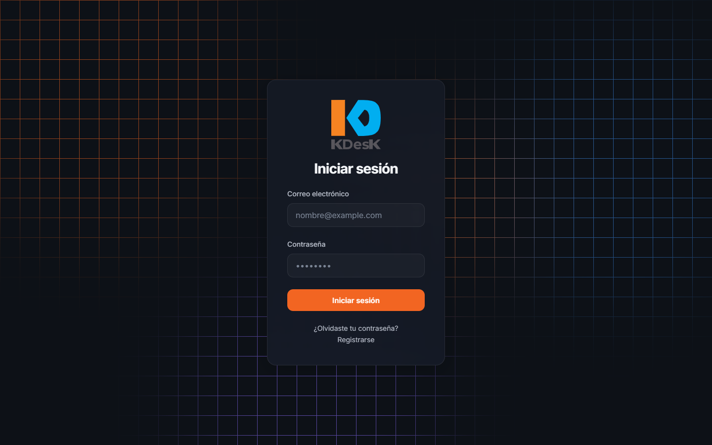
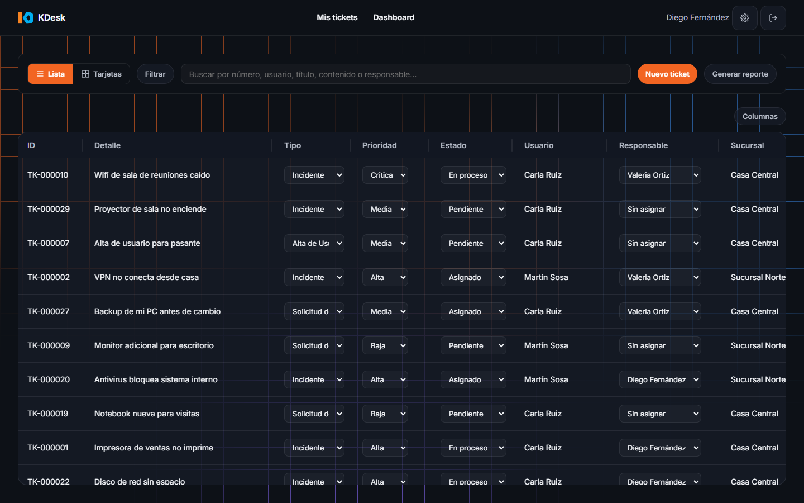
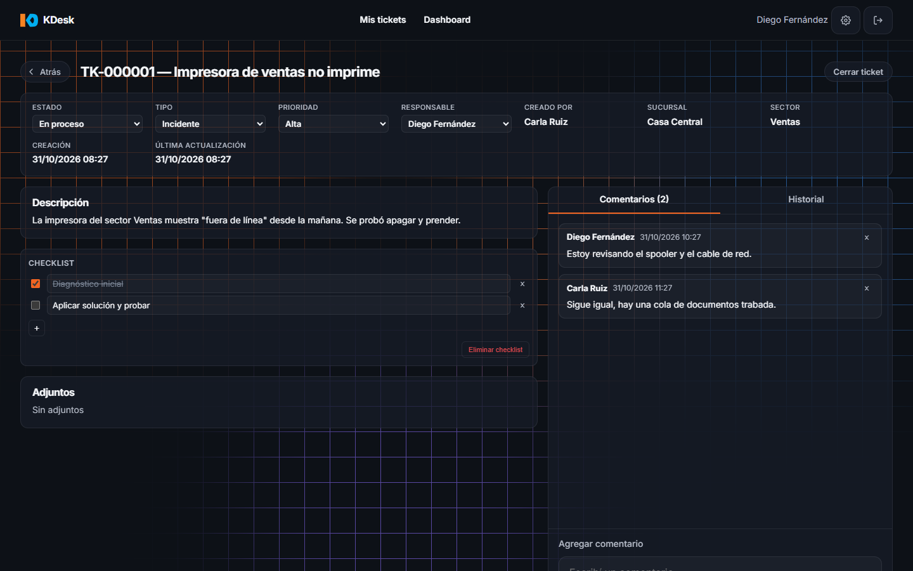
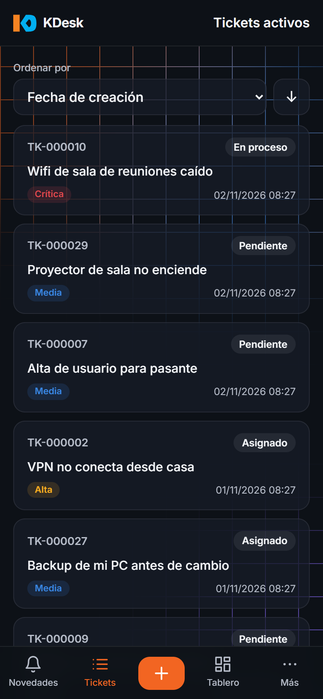
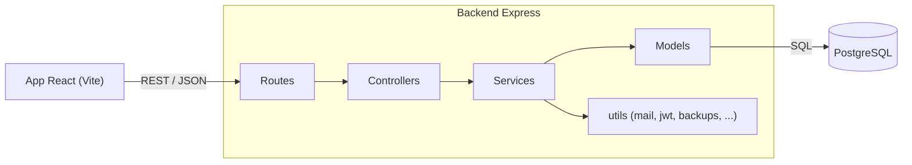

# KDesk (demo)

> Sistema interno de mesa de ayuda / tickets de soporte IT: ciclo de vida de tickets, roles y permisos, auditoría, backups y estadísticas, hecho con React, Express y PostgreSQL.

English version: [README.md](README.md)

Esta es la **versión pública de demostración** de un sistema que corre en producción dentro de una empresa. Contiene
el código con **datos ficticios únicamente**: sin datos de la empresa ni cuentas reales. La interfaz y la
documentación de `docs/` están en español rioplatense.

<!-- Capturas pendientes, ver docs/screenshots/README.md




-->

## Funcionalidades

- **Tickets**: alta, cambio de estado/prioridad/tipo, asignación a un técnico, comentarios, adjuntos, checklist de tareas técnicas, historial completo de cambios, cierre con comentario obligatorio.
- **Usuarios y permisos**: registro con activación por correo, login con contraseña, recuperación de contraseña, tres roles (usuario, técnico, administrador), habilitar/deshabilitar cuentas, blanqueo de contraseña por un administrador.
- **Login opcional con Microsoft 365 (Entra ID)** (OpenID Connect con PKCE), limitado a los tenants y dominios configurados. Se oculta si no está configurado.
- **Auditoría** con retención configurable.
- **Backups** de la base desde la propia aplicación (manuales y programados; usan `pg_dump`/`psql`).
- **Estadísticas**, **notificaciones y alertas** (popups, sonido, lectura por voz del navegador), preferencias de apariencia.
- **Versión móvil** (hasta 768 px): navegación inferior, tickets como tarjetas.
- **Kadi**, un asistente opcional que arma el ticket en una charla corta. **Apagada por defecto** (ver abajo).

## Stack

| Capa | Tecnología |
|---|---|
| Frontend | React 19, React Router 7, Vite 8, CSS puro, Context API |
| Backend | Node.js (módulos ES), Express 5, SQL puro con `pg` (sin ORM), JWT en cookies httpOnly, bcryptjs, Multer (adjuntos), Nodemailer |
| Base de datos | PostgreSQL |
| Tests | Vitest (backend con Supertest contra una base PostgreSQL de pruebas real; frontend con Testing Library) |

## Arquitectura



Capas estilo MVC: rutas -> controllers (HTTP) -> services (reglas de negocio) -> models (SQL). En el frontend toda la
comunicación HTTP pasa por `services/`. Detalle en [docs/ARCHITECTURE.md](docs/ARCHITECTURE.md).

## Arranque rápido

Requisitos: Node.js 22 o más nuevo (probado acá con Node 24) y PostgreSQL (o Docker).

**Opción A, Docker para la base**

```bash
docker compose up -d            # PostgreSQL con esquema + datos demo (base "kdesk_demo")
cp backend/.env.example backend/.env
cd backend && npm install && npm run dev
# en otra terminal
cd frontend && npm install && npm run dev
```

**Opción B, PostgreSQL local**

```bash
cp backend/.env.example backend/.env   # ajustá DB_HOST/DB_PORT/DB_USER/DB_PASSWORD a tu servidor
cd backend && npm install
npm run db:setup                        # crea la base desde database/schema.sql
npm run seed:demo                       # carga los usuarios demo y 30 tickets de ejemplo
npm run dev
# en otra terminal
cd frontend && npm install && npm run dev
```

Abrí http://localhost:5173. El backend escucha en http://localhost:4000 (Vite le redirige `/api`).

### Cuentas demo

Contraseña de todas: `Demo1234!`

| Cuenta | Rol |
|---|---|
| `admin@example.com` | administrador |
| `tecnico@example.com`, `tecnico2@example.com` | técnico |
| `usuario@example.com`, `usuario2@example.com` | usuario |

Los correos no se envían si no hay SMTP configurado: el backend los muestra por consola, con los links de activación o
recuperación. El botón "Entrar con Microsoft" aparece solo si están definidas las variables `M365_*`.

## Kadi (asistente de IA, apagada por defecto)

Kadi arma un ticket charlando con la persona. En esta demo está deshabilitada (`KADI_ACTIVA=off`): el chat no aparece
en la interfaz y el endpoint de mensajes responde 403. El motor (`backend/utils/claudeLocal.util.js`) es
intercambiable: la versión de este repo ejecuta el CLI local de Claude Code, pensado solo para desarrollo personal.
Se puede reemplazar por una llamada a cualquier API de LLM con tu propia clave.

## Tests

```bash
cd backend && npm run test:db && npm test    # necesita PostgreSQL; recrea la base "kdesk_test"
cd frontend && npm test
```

A la fecha: 83 tests de backend y 257 de frontend, todos pasando. El CI los corre en cada push
(`.github/workflows/ci.yml`).

## Estructura

```
backend/    API Express: routes, controllers, services, models, middleware, utils, jobs, tests
frontend/   App React: pages, components, context, hooks, services, styles
database/   schema.sql (tablas + catálogos) y seed-demo.sql (datos de demo)
docs/       Documentación del proyecto, notas de diseño de UI y checklist de capturas
```

## Alcance y seguridad

Diseñado para correr en una red interna. No hay rate limiting en login ni `helmet`: ambos son necesarios antes de
cualquier exposición a internet.

## Hecho con IA, auditado a mano

El proyecto se desarrolló con asistencia de IA (Claude Code). El código generado se revisó y validó manualmente antes
de cada despliegue, y el stack se limitó a tecnologías que el autor ya conoce para poder auditarlo. Los tests
automáticos forman parte de ese proceso, no lo reemplazan.

## Licencia

Código visible solo para evaluación, todos los derechos reservados: se puede leer y correr localmente para evaluarlo,
pero no usarlo, copiarlo, modificarlo ni redistribuirlo. Ver [LICENSE](LICENSE).
