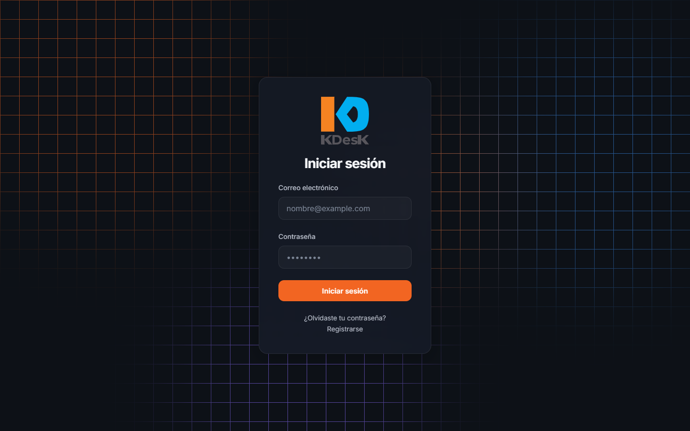
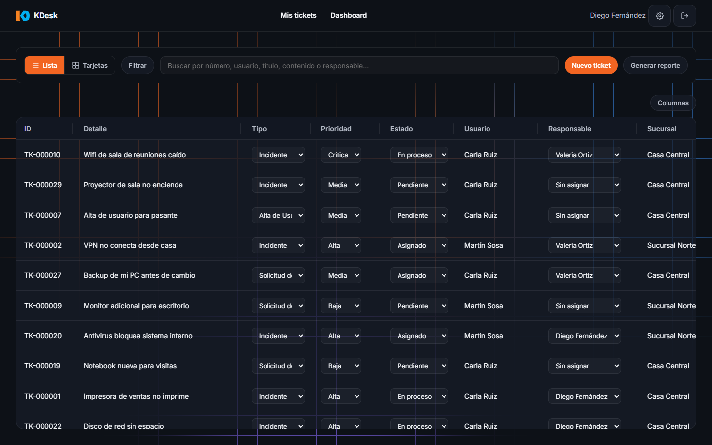
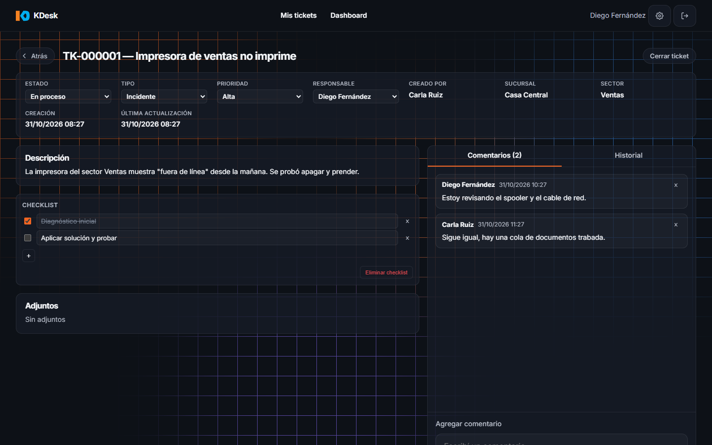
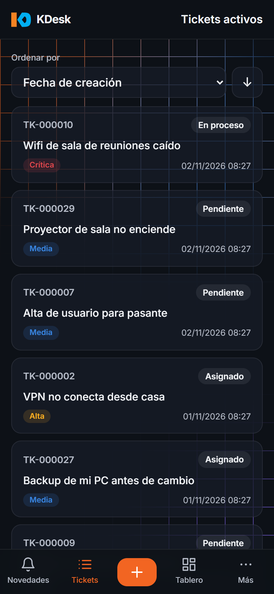
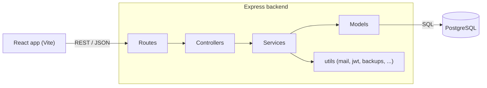

# KDesk (demo)

> An internal IT helpdesk / ticketing system: ticket lifecycle, roles and permissions, audit log, backups and statistics, built with React, Express and PostgreSQL.

Spanish version: [README.es.md](README.es.md)

This is the **public demo version** of a system that runs in production inside a company. It contains the code with
**fictitious demo data only**: no company data, no real accounts. The interface and the documentation in `docs/`
are in Spanish (Argentina).






More screens: [new ticket](docs/screenshots/04-new-ticket.png), [users and permissions](docs/screenshots/05-users-permissions.png).

## Features

- **Tickets**: creation, status/priority/type changes, assignment to a technician, comments, attachments, technical task checklist, full change history, closing with a mandatory comment.
- **Users and permissions**: registration with email activation, password login, password recovery, three roles (user, technician, administrator), enable/disable accounts, password reset by an administrator.
- **Optional Microsoft 365 (Entra ID) login** (OpenID Connect with PKCE), restricted to configured tenants and domains. Hidden unless configured.
- **Audit log** with configurable retention.
- **Backups** of the database from the app itself (manual and scheduled; uses `pg_dump`/`psql`).
- **Statistics** dashboard, **notifications and alerts** (popups, sound, browser text-to-speech), appearance preferences.
- **Mobile layout** (up to 768 px): bottom navigation, tickets as cards.
- **Kadi**, an optional assistant that builds a ticket through a short chat. **Off by default** (see below).

## Stack

| Layer | Technology |
|---|---|
| Frontend | React 19, React Router 7, Vite 8, plain CSS, Context API |
| Backend | Node.js (ES modules), Express 5, raw SQL with `pg` (no ORM), JWT in httpOnly cookies, bcryptjs, Multer (uploads), Nodemailer |
| Database | PostgreSQL |
| Tests | Vitest (backend with Supertest against a real PostgreSQL test database; frontend with Testing Library) |

## Architecture



MVC-style layering: routes -> controllers (HTTP) -> services (business rules) -> models (SQL). In the frontend, all HTTP
calls go through `services/`. Details in [docs/ARCHITECTURE.md](docs/ARCHITECTURE.md) (Spanish).

## Quick start

Requirements: Node.js 22 or newer (tested here with Node 24) and PostgreSQL (or Docker).

**Option A, Docker for the database**

```bash
docker compose up -d            # PostgreSQL with schema + demo data (database "kdesk_demo")
cp backend/.env.example backend/.env
cd backend && npm install && npm run dev
# in another terminal
cd frontend && npm install && npm run dev
```

**Option B, local PostgreSQL**

```bash
cp backend/.env.example backend/.env   # set DB_HOST/DB_PORT/DB_USER/DB_PASSWORD for your server
cd backend && npm install
npm run db:setup                        # creates the database from database/schema.sql
npm run seed:demo                       # loads the demo users and 30 sample tickets
npm run dev
# in another terminal
cd frontend && npm install && npm run dev
```

Open http://localhost:5173. The backend listens on http://localhost:4000 (Vite proxies `/api` to it).

### Demo accounts

Password for all of them: `Demo1234!`

| Account | Role |
|---|---|
| `admin@example.com` | administrator |
| `tecnico@example.com`, `tecnico2@example.com` | technician |
| `usuario@example.com`, `usuario2@example.com` | user |

Emails are not sent unless SMTP is configured: the backend prints them (with their activation / reset links) in its console.
The "Sign in with Microsoft" button only shows up when the `M365_*` variables are set.

## Kadi (AI assistant, off by default)

Kadi builds a ticket by chatting with the user. In this demo it is disabled (`KADI_ACTIVA=off`): the chat does not
appear in the UI and the message endpoint answers 403. The engine (`backend/utils/claudeLocal.util.js`) is
replaceable: the version in this repo runs the local Claude Code CLI, intended only for personal development.
It can be swapped for a call to any LLM API with your own key.

## Tests

```bash
cd backend && npm run test:db && npm test    # needs PostgreSQL; recreates the "kdesk_test" database
cd frontend && npm test
```

At the time of writing: 83 backend tests and 257 frontend tests, all passing. CI runs them on every push
(`.github/workflows/ci.yml`).

## Project structure

```
backend/    Express API: routes, controllers, services, models, middleware, utils, jobs, tests
frontend/   React app: pages, components, context, hooks, services, styles
database/   schema.sql (tables + catalogs) and seed-demo.sql (demo data)
docs/       Project documentation (Spanish), UI design notes and screenshot checklist
```

## Security scope

Designed for an internal network. There is no rate limiting on login and no `helmet`; both are required before any
public exposure. See [README.es.md](README.es.md) for the original discussion.

## Built with AI, audited by hand

This project was developed with AI assistance (Claude Code). The generated code was reviewed and validated by hand
before each deployment, and the stack was kept to technologies the author already knows well in order to be able to
audit it. The automated test suites above are part of that process, not a substitute for it.

## License

Source-available for evaluation only, all rights reserved: you may read the code and run it locally to evaluate it,
but not use, copy, modify or redistribute it. See [LICENSE](LICENSE).
